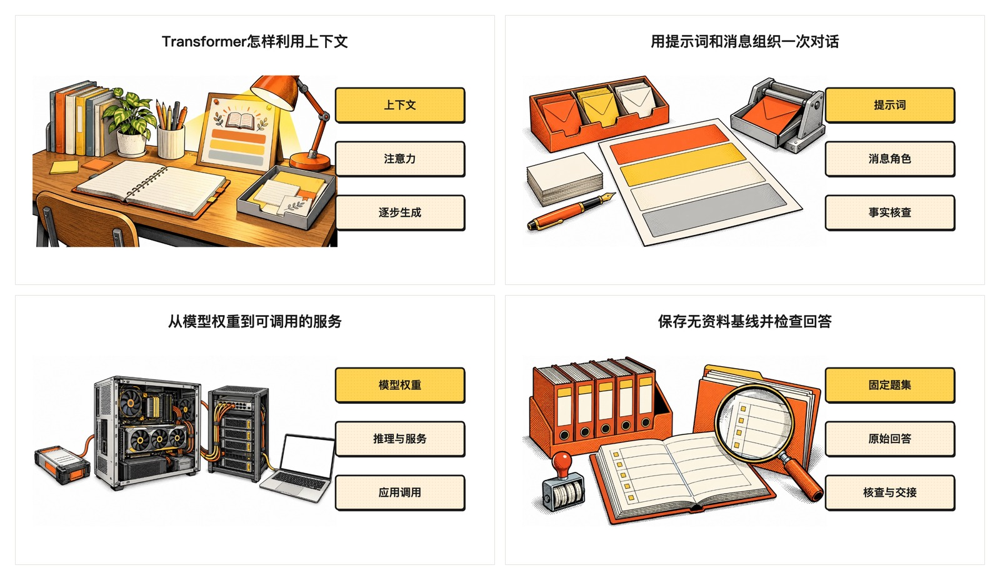
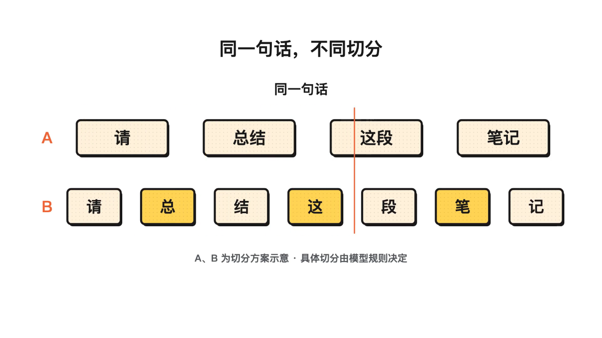
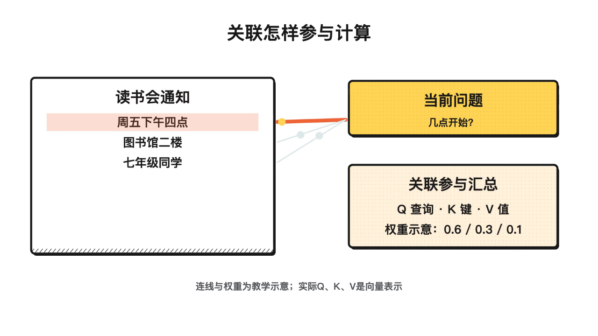
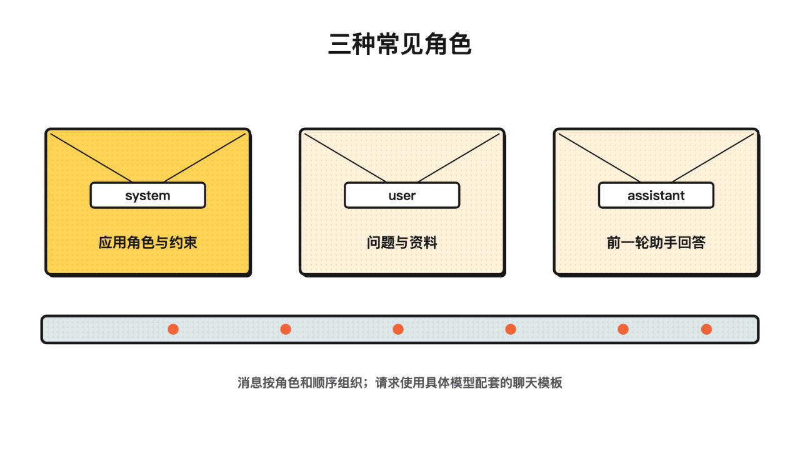
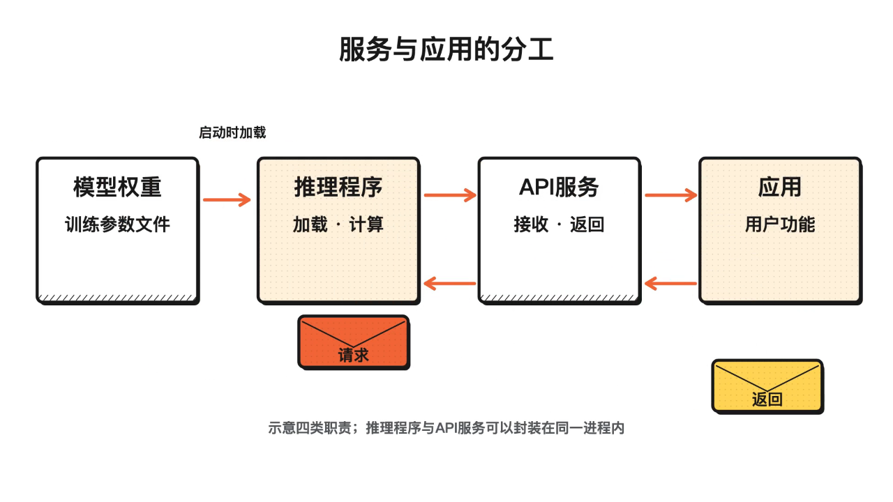
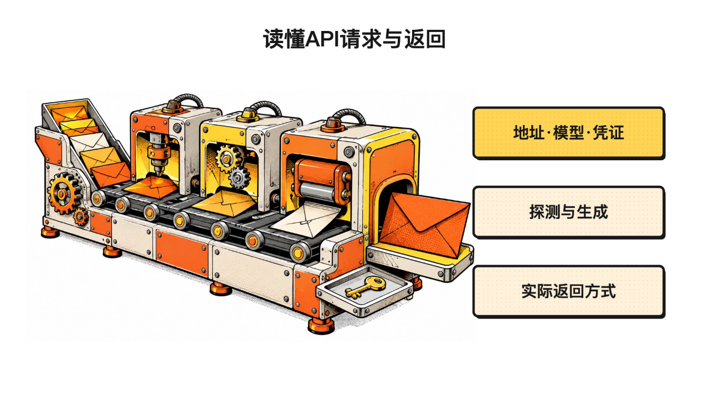
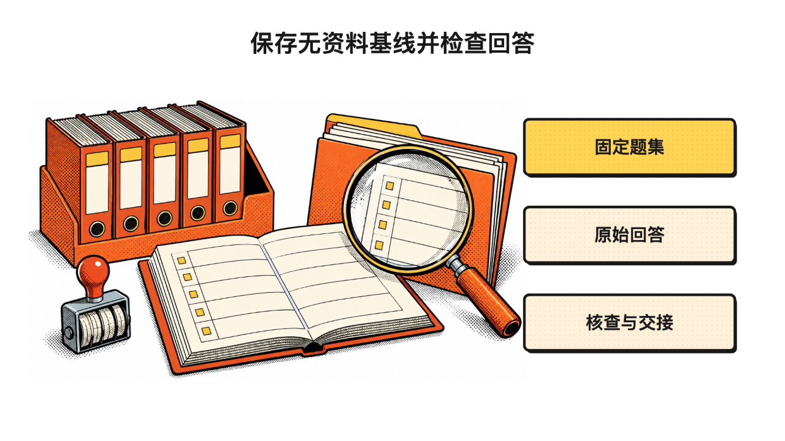
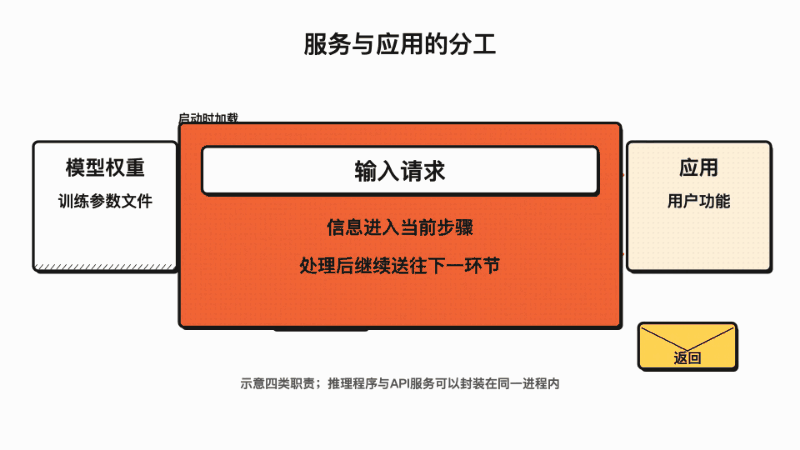
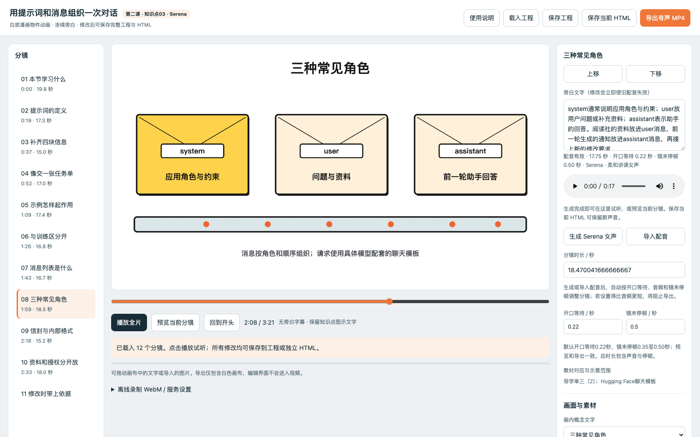

<div align="center">

# Knowledge to Video

### 从教材里的一个知识点，到学生看得懂、老师改得动的讲解视频。

[](验收记录.json)

**提供教材、导学单和参考素材，让 Agent 完成教学编排、分镜、动画、配音与工程交付。**

每个知识点独立制作，先做一个样片，确认内容、画风、动作和声音后，再继续整套课程。

[看案例](#第二课案例画廊) · [开始使用](#开始使用) · [编辑与导出](#编辑与导出) · [文件整理](#交付目录) · [验证方法](#如何验证)

</div>

<p align="center">
  
</p>

<p align="center"><sub>第二课已完成课程的实际画面：纯白背景、漫画物件、大主体，用具体场景带入抽象概念。</sub></p>

> 本 Skill 从第二课的实际制作与反复修改中整理而来。下面的课程截图展示这套方法的实践；v1.0 通用模板与工具链另有独立的功能验收记录。图片均截取自已有课程，来源和时间点见 [展示素材记录](docs/readme/media-sources.json)。

---

## 你会拿到什么

| 交付物 | 用来做什么 |
|---|---|
| **有声 MP4** | 直接观看、授课和分享，画面包含动画与概念标注 |
| **可编辑 HTML 工程** | 修改旁白、画面文字、素材、分镜顺序和时间轴，再保存、导出 |
| **剪映素材** | 无旁白字幕版视频、独立 SRT、分镜旁白、分镜配音和静态画面参考 |
| **资料与来源** | 核对教材依据、补充资料、素材来源、AI 生成过程和实际检查结果 |

默认的“无旁白字幕版”**保留女性旁白声音，画面隐藏旁白字幕**。知识点图示中的短词、代码和标签仍可显示。

---

## 开始使用

### 1. 获取完整 Skill

```bash
git clone https://github.com/Wenping-Liu/knowledge-to-video.git
```

保留整个文件夹，包括 `SKILL.md`、`references/`、`scripts/`、`assets/` 和 `tests/`。将其放入目标 Agent 支持的 Skill 目录，或直接让能读取本地文件的 Agent 阅读其中的 `SKILL.md`。

本 Skill 的完整制作过程需要文件读写、代码执行，以及本地浏览器和音视频工具。具体依赖见 [运行环境](references/runtime.md)。

### 2. 给出教材位置与制作要求

```text
请读取 knowledge-to-video/SKILL.md，按这个 Skill 制作。

教材、导学单、已有图片和参考视频在“第二课”文件夹。
面向零基础学生，先完成第一个知识点样片。
使用白底漫画和 Serena 温和女声，画面不显示旁白字幕。
请交付可编辑 HTML、有声 MP4、剪映素材及资料来源。
```

已有样片确认后，可以继续说：

```text
沿用已经确认的讲课方式、画风和声音，制作其余知识点。
每个知识点独立一个文件夹，按规定目录整理。
```

需要修改时，把范围说清楚即可：

```text
只修改第三镜的旁白和图片。
重新生成该镜配音，调整时间轴，并更新 HTML、MP4 和 SRT。
```

### 3. 先确认一个样片

核对四件事：**内容讲清楚了吗、画风合适吗、动作帮助理解吗、声音自然吗**。已有确认意见会随工程保留，后续制作继承相同标准。

---

## 第二课案例画廊

以下为已有成片的静态截图。点击图片可查看大图；实际动画见后面的动图示例。

### 把抽象概念变成看得见的关系

| 01 · 文字怎样变成模型的输入 | 02 · Transformer 怎样利用上下文 |
|---|---|
| [](docs/readme/01-token.png) | [](docs/readme/02-context.png) |
| 用同一句话演示切分差异，并说明具体切法由配套分词器决定。 | 从读书会通知进入上下文，再解释关联计算及比喻边界。 |

### 把程序分工变成有顺序的流程

| 03 · 用提示词和消息组织一次对话 | 04 · 从模型权重到可调用的服务 |
|---|---|
| [](docs/readme/03-messages.png) | [](docs/readme/04-service.png) |
| 用角色信封帮助理解消息分工，同时补充真实聊天模板的作用。 | 沿着请求经过的环节，分清文件、执行计算的程序、服务和应用。 |

### 把调用过程与检查依据连起来

| 05 · 读懂 API 请求与返回 | 06 · 保存无资料基线并检查回答 |
|---|---|
| [](docs/readme/05-api.png) | [](docs/readme/06-baseline.png) |
| 说明地址、模型、凭证，以及服务探测、回答内容和实际返回方式。 | 保留可比较的原始回答，核对题目覆盖、内容依据和交接记录。 |

### 让对象在画面里完成动作

<p align="center">
  
</p>

<p align="center"><sub>从知识点 04 成片截取的 6 秒无声动图。正式视频可包含统一女性旁白；GIF 仅展示画面动作。</sub></p>

---

## 核心制作方法

### 先解释准确，再举例，最后说清适用范围

抽象概念沿着三步展开：

**准确解释 → 具体实例或形象比喻 → 比喻对应的机制与边界。**

例如，用“资料袋”帮助理解一次请求携带哪些信息，再说明模型实际处理的是 Token 及其表示；用“角色信封”帮助理解消息分工，再说明服务会采用配套的聊天模板。

旁白采用连贯的教师讲解：开头“大家好，我是曦曦”，接着明确本节学习内容，再进入情景；结尾用一句话总结。教材依据保留在来源记录中，讲解自然衔接。

### 七个工作模块

| 顺序 | 模块 | 核心任务 |
|---|---|---|
| ① | 资料与范围 | 核对教材、导学单、拓展阅读和已确认要求 |
| ② | 教学与讲稿 | 覆盖知识点，编写定义、实例、边界及完整讲解 |
| ③ | 分镜与素材 | 设计对象动作，复用、搜索或生成合适素材 |
| ④ | 配音与时间轴 | 生成或导入配音，按实际声音安排节奏 |
| ⑤ | 可编辑工程 | 保留文字、图层、素材、动画和工程数据 |
| ⑥ | 检查与修正 | 核验内容、画面、声音及编辑导出链路 |
| ⑦ | 文件整理 | 独立打包每个视频，交付剪映素材与资料记录 |

分镜与画面检查优先结合可用的 [huashu-art-motion](https://github.com/alchaincyf/huashu-art-motion)。本仓库附带独立 Canvas 模板，按项目需要扩展动画；素材和构图随知识点重新创作。

### 声音与时间轴

- 默认 **Qwen3-TTS 12Hz 1.7B CustomVoice · Serena**，定位为温和、清晰、连贯的女老师。
- 默认开口等待约 **0.22 秒**、镜末停顿约 **0.50 秒**，根据实际试听调整。
- 修改旁白或声音配置后，旧音频标记失效，重新生成或导入后再导出。
- 配音生成期间切换镜头，结果绑定原镜头；原文稿已变化时拒绝绑定旧请求结果。
- SRT 有核对后的句级计时则使用句级计时；否则按每镜的真实旁白区间输出，并标明需要时再细分。

模型权重单独配置。默认配音在本地生成，具体适配方式与依赖见 [配音规范](references/04-voice-and-timing.md) 和 [运行环境](references/runtime.md)。

---

## 编辑与导出

<p align="center">
  
</p>

<p align="center"><sub>第二课已有工程的真实编辑界面。通用模板沿用分镜、画面、旁白和时间轴的编辑思路，界面布局可能不同。</sub></p>

| 可以修改 | 修改后怎样保留 |
|---|---|
| 旁白与画面文字 | 保存工程数据，重新生成受影响镜头的声音 |
| 图片、位置、大小与显隐 | 素材随工程保存，支持导出当前完整 HTML |
| 分镜顺序、时长与动画关键帧 | 按当前工程重新计算、检查和渲染 |
| 生成或导入的分镜音频 | 保存文稿绑定与音频指纹，检查有效状态 |

**离线可用：**内嵌 HTML 播放与编辑、图片/配音导入、JSON 保存恢复、保存当前 HTML；浏览器支持时可录制有声 WebM。

**需要本地服务：**Serena 配音生成、短片预处理、保存到交付目录、有声 MP4 导出。首次安装依赖与模型、资料搜索和可选图片生成需要相应网络能力。

本地 MP4 导出默认写入当前视频文件夹。HTML/JSON 的浏览器下载位置由浏览器保存设置决定。预览与导出使用同一个画面渲染函数，编辑界面留在视频画面之外。

---

## 交付目录

```text
01-视频名称/
├── 视频名称.mp4
├── 启动编辑器.command          # 按当前系统提供入口
├── 使用说明.txt
├── 剪映素材/
│   ├── 无旁白字幕版.mp4         # 有旁白声音，画面无旁白字幕
│   ├── 字幕.srt
│   ├── 分镜旁白.txt
│   ├── 分镜配音/               # 001、002…按镜头顺序编号
│   ├── 分镜画面参考/           # 静态参考图
│   ├── 无旁白字幕版-流畅播放720p.mp4  # 需要时提供
│   └── 透明曦曦/               # 可选，默认不生成、不出镜
├── 可编辑工程/
│   ├── 编辑器.html
│   ├── 工程数据.json
│   ├── 动画代码/
│   ├── 图片/
│   ├── 案例视频/
│   ├── 配音/
│   ├── runtime/
│   └── runtime.settings.json
└── 资料与来源/
    └── 教材依据、参考链接、素材来源、AI生成与核验记录
```

**剪映交接：**将无字幕有声视频放到时间轴，再从 0 秒对齐导入 SRT。SRT 只包含字幕文字和时间码，声音来自视频；字体和动画在剪映中设置。请避免将 SRT 叠加到已经带有字幕的成片上。

清理旧版时，先验证最终成片及新目录工程可用，再处理被替代的输出、缓存和临时文件，保留独有原始素材及其他项目。完整规范见 [文件整理](references/07-delivery-and-cleanup.md)。

---

## 如何验证

在 Skill 文件夹中执行：

```bash
# 检测本机环境
python3 scripts/doctor.py

# 基础检查，输出到独立测试目录
python3 tests/run_checks.py --out ../knowledge-to-video-check

# 浏览器操作和真实有声视频链路
python3 tests/run_checks.py --out ../knowledge-to-video-check --browser --video

# 已配置本地模型时，再验证真实Serena生成
python3 tests/run_checks.py --out ../knowledge-to-video-check --browser --video --serena
```

已在 **macOS Apple Silicon** 完成 40 项功能回归，覆盖文稿改动、异步配音绑定、保存恢复、有声 MP4/WebM、移动工程后渲染，以及真实 Serena 生成；另完成时长显示复验。

[查看验收记录](验收记录.json) · [查看精简测试证据](tests/evidence) · [完整使用与验证说明](使用与验证.txt)

技术检查之后，还需要用真实教材完整观看、试听样片，核对知识点覆盖、比喻边界、文字可读性、动作解释力、讲解节奏与音画同步。

---

## 运行条件与当前范围

| 项目 | 说明 |
|---|---|
| 基础运行 | Python 3.10+ |
| MP4 导出 | Playwright、Chromium、FFmpeg；优先用 ffprobe 探测，缺少时支持 FFmpeg 解析回退 |
| Serena 配音 | 本地 1.7B CustomVoice 模型及相应 MLX / PyTorch 运行环境 |
| 已实测平台 | macOS Apple Silicon，MLX 配音路线 |
| 待实机验证 | Windows/Linux 启动入口、PyTorch 配音适配器 |
| 按需制作 | 透明人物素材、复杂自定义动画及更高质量的短片处理策略 |

模型权重和第三方运行库需要单独准备。当前短片预处理默认最多 30 秒、8 fps 帧序列，保留原片；需要更流畅的片段时应调整处理策略并重新验证。宿主自动触发率和新教材的教学效果需分别评估。

---

## 仓库结构

```text
knowledge-to-video/
├── SKILL.md                 # 给Agent读取的主入口
├── README.md                # 使用概览与案例展示
├── 使用与验证.txt            # 详细操作与复验命令
├── 验收记录.json             # 实际验证范围与结果
├── agents/openai.yaml       # 界面信息与默认调用提示
├── references/              # 七个模块与运行环境规范
├── scripts/                 # 创建、配音、渲染、打包、核验与服务
├── assets/                  # 编辑器、Schema、声音画风配置及模板
├── tests/                   # 回归检查、触发用例与精简证据
└── docs/readme/             # 第二课截图、动图及来源记录
```

## 参考与致谢

- [huashu-design](https://github.com/alchaincyf/huashu-design)：本 README 的展示结构参考。
- [huashu-art-motion](https://github.com/alchaincyf/huashu-art-motion)：分镜、动画语言与画面检查方法参考。
- [Qwen3-TTS](https://github.com/QwenLM/Qwen3-TTS)、[MLX Audio](https://github.com/Blaizzy/mlx-audio)：本地语音方案。
- [Agent Skills](https://agentskills.io/specification)：Skill 文件组织规范。

展示图片和动图截取自本项目第二课已完成课程。教材、模型、字体与第三方素材的使用遵循各自的来源和许可记录。
