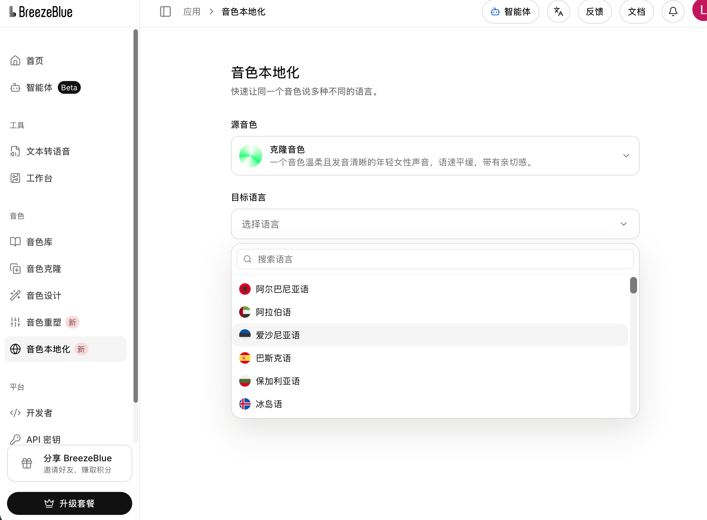
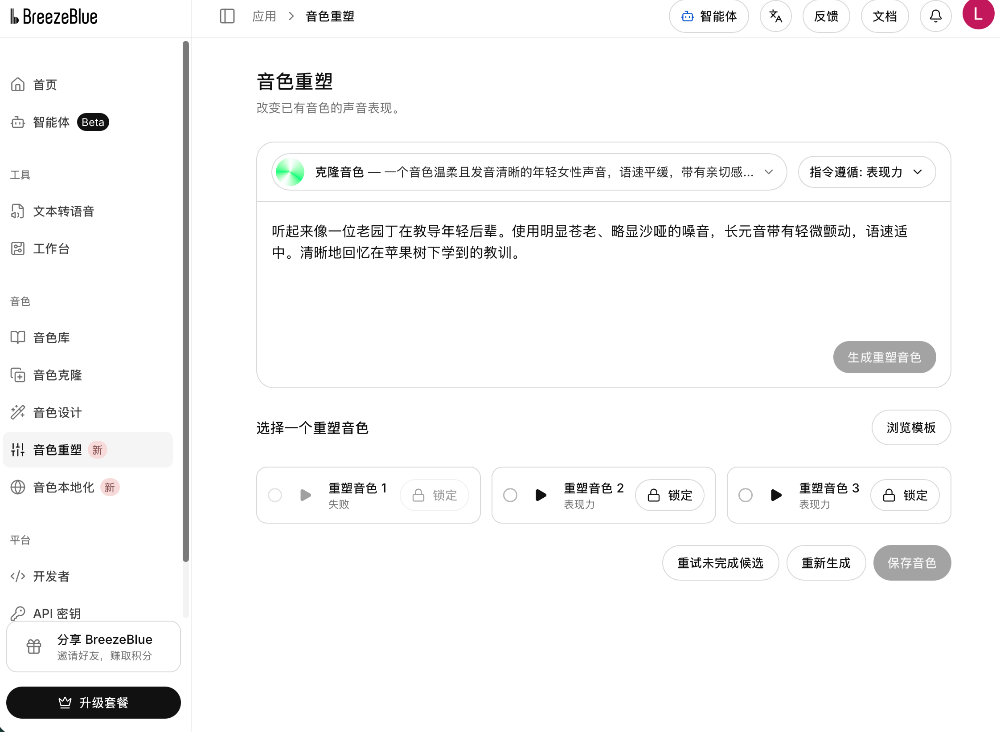

<div align="center">

# Knowledge to Video

### 从教材里的一个知识点，到学生看得懂、老师改得动的讲解视频。


**提供教材、导学单和参考素材，让 Agent 完成教学编排、分镜、动画、配音与工程交付。**

每个知识点独立制作，先做一个样片，确认内容、画风、动作和声音后，再继续整套课程。

[先看有声视频](docs/demo/README.md) · [看案例](#第二课案例画廊) · [开始使用](#开始使用) · [编辑与导出](#编辑与导出) · [文件整理](#交付目录) · [验证方法](#如何验证)

</div>

<p align="center">
  
</p>

<p align="center"><sub>第二课已完成课程的实际画面：纯白背景、漫画物件、大主体，用具体场景带入抽象概念。</sub></p>

> 本 Skill 从第二课的实际制作与反复修改中整理而来。下面的课程截图展示这套方法的实践；旧版通用模板与工具链另有独立的功能验收记录；旧案例截图不等于已经符合 v1.2 的教学验收。图片均截取自已有课程，来源和时间点记录保留在源码的素材记录中。

---

## 项目亮点

### 亮点一：直接生成可编辑的知识点讲解动画

把知识点、教材或教案交给具备执行工具的智能体，调用本Skill，完成连续讲稿、分镜设计、机制动画、配音与时间轴校准，交付可用于课堂的有声视频。老师可以继续修改讲稿、画面文字、图片、图层与分镜，再重新配音和导出。

| 知识机制动画：文字如何成为模型输入 | 可编辑工程：继续调整内容与画面 |
|---|---|
|  |  |

以上为已制作课程及编辑器的实际截图。当前制作由智能体与本地工具执行；完整视频效果见[有声案例](docs/demo/README.md)。

#### 动画工程包含什么

| 交付物 | 用来做什么 |
|---|---|
| **有声 MP4** | 直接观看、授课和分享，画面包含动画与概念标注 |
| **可编辑 HTML 工程** | 修改旁白、画面文字、素材、分镜顺序和时间轴，再保存、导出 |
| **剪映素材** | 无旁白字幕版视频、独立 SRT、分镜旁白、分镜配音和静态画面参考 |
| **资料与来源** | 核对教材依据、补充资料、素材来源、AI 生成过程和实际检查结果 |

默认的“无旁白字幕版”**保留女性旁白声音，画面隐藏旁白字幕**。知识点图示中的短词、代码和标签仍可显示。


### 亮点二：克隆教师声音，定制自己的讲解音色

通过 **BreezeBlue音色定制 + 知映视频制作**，让课程拥有适合教师、学生和教学场景的声音：

| 能力 | 可以怎样用 |
|---|---|
| **音色设计** | 用自然语言描述声音，让平台智能体生成温和讲课、活泼科普等候选音色，试听后保存 |
| **声音克隆** | 用本人或已授权的录音创建可复用音色，让自己的声音用于知识讲解 |
| **音色本地化与多语言** | 为同一声音建立英语、日语、西班牙语等语言版本，用于外语教学和多语言课程 |
| **音色重塑** | 在原音色基础上调整音高、年龄感、节奏、活力与表达风格，保存为新的声音 |
| **接入视频制作** | 复制Voice ID，由Skill生成分镜旁白；修改讲稿后重新配音、校准动画与字幕，导出有声视频 |

| 音色本地化：选择目标语言 | 音色重塑：调整风格并试听 |
|---|---|
| [](docs/breeze/README.md) | [](docs/breeze/README.md) |

**[图文教程与28秒真实试听](docs/breeze/README.md)**。音色设计、克隆、本地化和重塑在Breeze网站完成，Skill已直接接入保存后Voice ID的配音接口。多语言可通过工程语言参数配置；当前已实测中文，其他语言与音色效果需逐项试听验证。

### 亮点三：教师自己的数字人，以曦曦展示形象与动作

让教师拥有可用于开场、引导和结尾的讲解形象，与自己的声音、知识动画组合使用。这里先用**曦曦数字人样例**展示：形象保持一致，支持透明背景素材，已制作的8秒独立样例包含挥手、眨眼、分层迈步和随旁白变化的简化猫嘴口型。


*上图是现有动画的静态检查帧，棋盘格用于检查透明背景，图片本身不是动画播放器。*

已将曦曦加入169.5秒的项目介绍，按原旁白时间轴驱动近似卡通口型。[下载曦曦出镜版介绍视频播放](docs/demo/media/project-demo.mp4)。

当前Skill已支持将获授权的透明角色PNG作为独立图层，调整位置、尺寸、显隐与关键帧；曦曦动作和口型属于另外制作的独立样例，尚未集成为通用数字人生成器。教师真人或专属卡通形象需要先准备相应素材并单独适配；不能把静态角色导入等同于自动真人建模或精确口型同步。角色可选，课堂核心仍是知识过程的动画演示。

角色图与品牌元素仅用于本项目效果展示，不因仓库代码采用MIT而获得同等素材授权。[当前角色接入方式](references/10-providers-and-avatar.md#曦曦虚拟讲解角色)。

---

## 教师和学生怎样开始

1. 将仓库链接发给自己的智能体：**“请安装这个 knowledge-to-video Skill，检查可用环境。”**
2. 提供上课要讲的知识点、教案或教材，说明学段与用途：教师备课或课堂讲解，学生自学或备考。
3. 指定声音和画面：默认千问Serena、白底漫画物件；晓晓或BreezeBlue等可按接入状态选择；曦曦角色按需出镜。
4. 请智能体使用`$knowledge-to-video`先开发一支样片，核对内容、动作和声音后，再制作其他知识点。
5. 在HTML中修改讲稿和素材，重新配音与校准，导出有声MP4及对应SRT。

完整步骤见[用户指南](references/09-user-guide.md)，能力和配置见[声音 智能体与曦曦](references/10-providers-and-avatar.md)。本项目面向全学科设计，现有实测案例以大模型课程为主。

**先看效果：**观看[有声项目演示与课程案例](docs/demo/README.md)。需要制作自己的课程时，克隆仓库并按使用指南运行本地工具；任务配置和编辑工程保留在源码中。当前完整视频制作由智能体和本地工具执行。

### 实际案例预览

| 训练与推理 | 模型评测 |
|---|---|
| [](docs/demo/media/training.mp4) | [](docs/demo/media/evaluation.mp4) |
| LoRA参数适配 | RAG资料链路 |
| [](docs/demo/media/lora.mp4) | [](docs/demo/media/rag.mp4) |

**点击截图即可打开对应有声MP4；若GitHub页面未显示播放器，点击Raw／Download下载后观看。** [全部视频入口](docs/demo/README.md)包含四段案例、约2分50秒的项目演示，以及一支完整可编辑讲解样例。

案例直接基于GitLink上[Christin-liu / Full_Link_Development_of_Large_Models](https://www.gitlink.org.cn/Christin-liu/Full_Link_Development_of_Large_Models)仓库中“两天培训材料包”的知识点和实践任务开发，该材料包源于《大模型全链路开发：基于书生开源体系的项目实战》。项目已形成前五课27支独立知识点视频；本仓库公开精选片段和一套完整样例，原始教材与其余完整课程不随仓库分发。

观看[实际视频](docs/demo/README.md)，或阅读[技术文档与推广计划](docs/technical.md)。来源与截取记录保留在源码中。历史课程片段展示已有制作效果，不代表全部已按v1.3重制或已经过课堂效果实验。

v1.3本轮通过55项单元检查、44项浏览器/音视频检查和10项MVP操作检查。证据分别保存在`tests/evidence/v1.3-*.json`；Azure为模拟请求，Azure真实账号调用与课堂效果仍待验证；Breeze已新增同步API，当前实测与图文教程见下方入口。

## v1.3 可选择的能力

| 层次 | 默认与选项 | 验证边界 |
|---|---|---|
| 声音 | Qwen3-TTS 1.7B Serena；Azure晓晓；BreezeBlue自选Voice ID与其他音频导入 | Qwen本地生成实测；Azure模拟请求测试、待账号实测；Breeze同步API已接入，详见音色教程 |
| 编程智能体 | Codex实际验证；其他具备文件和执行工具的智能体可适配 | 具体编程模型由宿主选择，不捆绑单一模型API |
| 角色 | 纯动画默认；曦曦透明PNG独立图层可选 | 可调整位置大小，不等同自动口型同步 |
| 案例 | 多课真实片段、原始工程与来源记录 | 展示产物和工具能力，不代表已经完成课堂效果实验 |

## v1.2：让讲解和动画按同一条主线前进

这次修订针对实际课程里出现的断句、场景跳跃、装饰循环和文字缺失。新的工程要求先写连续讲稿，再把每段话绑定到具体对象的状态变化；配音变化后重新对齐这些动作。

| 实际问题 | 制作规则与实现 | 如何验证 |
|---|---|---|
| 学生听着不知道在讲什么 | 开头先点题；同一生活案例贯穿引入、机制和总结；新术语先定义、再解释和举例、说明边界 | 连续全文审稿；逐镜记录承接关系与案例回扣，知识断言对应真实材料 |
| 画面像PPT，或一直重复晃动 | 教学节拍写清“什么对象从什么状态变成什么”；超过5秒无有效变化要修正，装饰/整图推近/循环不计为教学动作 | `quality.py`查空缺区间，正常速度复看机制是否真的成立 |
| 改稿后声音、字幕和动作错位 | 原始配音与表达指令一起签名；真实声音计时驱动`beats`和关键帧`anchor` | 改配音→对齐→重排动作→导出；旧音频、旧计时会被拒绝 |
| 定义缺文字，素材不易改 | 以第二课第一知识点Serena版为视觉基准，大幅漫画物件搭配少量关键词、简短定义和案例数据；机制图保留可编辑矢量对象；每镜附分组SVG源图 | 编辑器可保存当前SVG，检查对象ID与文字、预览和成片 |
| 技术通过被当成教学完成 | 技术链路、教学结构、事实/叙事/视觉/听感分别记录 | 没有真实证据的项目保持待复核，不自动宣称讲得好或声音自然 |

默认开场为“大家好，我是曦曦，今天我们要学习……”，结尾先说“本节课我们学习了……，它就是……”，最后“本节课的学习就到这里了，同学们再见”。Serena身份固定，本镜表达可指定提问、慢讲定义、轻快实例和收束；实际效果仍需试听。颜色按内容选择，当前课程继续白底、无讲解员、无旁白字幕。

详细数据约定见[教学计划与语音锚点](references/08-teaching-contract.md)，制作原则见[连贯讲稿](references/02-teaching-and-script.md)与[教学动作](references/03-storyboard-and-media.md)。复杂机制可选Remotion或HyperFrames；已有Canvas工程可继续使用同一渲染器，保持预览、编辑与导出一致。

---

## 开始使用

### 1. 获取完整 Skill

```bash
git clone https://github.com/Wenping-Liu/knowledge-to-video.git
cd knowledge-to-video
```

保留整个文件夹，包括 `SKILL.md`、`references/`、`scripts/`、`assets/` 和 `tests/`。将其放入目标 Agent 支持的 Skill 目录，或直接让能读取本地文件的 Agent 阅读其中的 `SKILL.md`。

本 Skill 的完整制作过程需要文件读写、代码执行，以及本地浏览器和音视频工具。具体依赖见 [运行环境](references/runtime.md)。

### 2. 首次运行安装器

```bash
python3 scripts/setup.py --yes
```

安装器会按系统选择运行路线：Apple Silicon 默认 MLX，其他平台默认官方 PyTorch 路线；创建隔离 Python 环境，准备浏览器、FFmpeg 和 Serena 模型，最后实际生成一支有声验证短片。**系统 Python 和已有课程文件保持原样。**

建议先准备 Python 3.12；已有 `uv` 时可由安装器准备用户级 Python。首次模型下载需要数 GB 空间（MLX 8bit 约 3.1 GB），另有浏览器和 Python 依赖；之后复用本地缓存。macOS 可运行根目录 `安装环境.command`，Windows 运行 `安装环境.cmd`，Linux 运行 `安装环境.sh`。Windows 命令行也可用 `py -3.12 scripts/setup.py --yes`。

按需选择：

```bash
# 已经有模型：复用它，省去模型下载
python3 scripts/setup.py --yes --model-path "/你的本地模型目录"

# 暂时只做画面和视频导出：跳过自动配音和模型下载
python3 scripts/setup.py --yes --voice none

# 只看安装计划，暂不下载或修改文件
python3 scripts/setup.py --plan
```

安装成功后检查：

```bash
python3 scripts/doctor.py --check
```

后续命令会自动使用已配置的隔离环境。模型、依赖和本机路径存放在本机缓存，不进入 Git 仓库。安装中断可按日志提示修复后重跑同一命令，已有下载和环境保留。完整参数与常见问题见 [安装与运行说明](references/runtime.md)。

### 3. 给出教材位置与制作要求

```text
请读取 knowledge-to-video/SKILL.md，按这个 Skill 制作。

教材、导学单、已有图片和参考视频在“第二课”文件夹。
面向零基础学生，先完成第一个知识点样片。
使用白底漫画和 Serena 温和女声，画面不显示旁白字幕。
请交付可编辑 HTML、有声 MP4、剪映素材及资料来源。
```

已有样片确认后，可以继续说：

```text
沿用已经确认的讲课方式、画风和声音，制作其余知识点。
每个知识点独立一个文件夹，按规定目录整理。
```

需要修改时，把范围说清楚即可：

```text
只修改第三镜的旁白和图片。
重新生成该镜配音，调整时间轴，并更新 HTML、MP4 和 SRT。
```

### 4. 检查讲稿、语音计时与样片

先用新规则完成一个完整知识点，核对内容、连贯性、机制动作和声音，再按确认标准扩展。新标准不能仅凭旧样片的“画风认可”视为已经通过。

```bash
python3 scripts/quality.py --project "/视频/可编辑工程/工程数据.json" --stage script
python3 scripts/voice.py --project "/视频/可编辑工程/工程数据.json"
# 可选本地强制对齐模型，或导入已核对的完整cues
python3 scripts/align.py --project "/视频/可编辑工程/工程数据.json" --model "/本地对齐模型"
python3 scripts/quality.py --project "/视频/可编辑工程/工程数据.json" --stage timing
python3 scripts/render.py --project "/视频/可编辑工程/工程数据.json"
python3 scripts/package.py --project "/视频/可编辑工程/工程数据.json"
```

MLX本地对齐可在工程配置`alignmentModelPath`后随TTS一并执行；其他平台可以使用其他对齐工具并导入cues。对齐只确定给定文本的位置，不能代替核听。核心安装过程沿用v1.1，不强制额外下载对齐模型。

已有工程没有`teaching`计划时仍可编辑与导出，报告标记为旧版技术检查；引入新标准需补计划和节拍。更新现有工程的runtime前先保留其自定义renderer，不直接用模板覆盖课程动画。

---

## 第二课案例画廊

以下为已有成片的静态截图。点击图片可查看大图；实际动画见后面的动图示例。

### 把抽象概念变成看得见的关系

| 01 · 文字怎样变成模型的输入 | 02 · Transformer 怎样利用上下文 |
|---|---|
| [](docs/readme/01-token.png) | [](docs/readme/02-context.png) |
| 用同一句话演示切分差异，并说明具体切法由配套分词器决定。 | 从读书会通知进入上下文，再解释关联计算及比喻边界。 |

### 把程序分工变成有顺序的流程

| 03 · 用提示词和消息组织一次对话 | 04 · 从模型权重到可调用的服务 |
|---|---|
| [](docs/readme/03-messages.png) | [](docs/readme/04-service.png) |
| 用角色信封帮助理解消息分工，同时补充真实聊天模板的作用。 | 沿着请求经过的环节，分清文件、执行计算的程序、服务和应用。 |

### 把调用过程与检查依据连起来

| 05 · 读懂 API 请求与返回 | 06 · 保存无资料基线并检查回答 |
|---|---|
| [](docs/readme/05-api.png) | [](docs/readme/06-baseline.png) |
| 说明地址、模型、凭证，以及服务探测、回答内容和实际返回方式。 | 保留可比较的原始回答，核对题目覆盖、内容依据和交接记录。 |

### 让对象在画面里完成动作

<p align="center">
  
</p>

<p align="center"><sub>从知识点 04 成片截取的 6 秒无声动图。正式视频可包含统一女性旁白；GIF 仅展示画面动作。</sub></p>

---

## 核心制作方法

### 先解释准确，再举例，最后说清适用范围

抽象概念沿着三步展开：

**准确解释 → 具体实例或形象比喻 → 比喻对应的机制与边界。**

例如，用“资料袋”帮助理解一次请求携带哪些信息，再说明模型实际处理的是 Token 及其表示；用“角色信封”帮助理解消息分工，再说明服务会采用配套的聊天模板。

旁白采用连贯的教师讲解：开头“大家好，我是曦曦，今天我们要学习……”，明确本节学习内容，再进入情景；结尾用一句话总结。教材依据保留在来源记录中，讲解自然衔接。

### 七个工作模块

| 顺序 | 模块 | 核心任务 |
|---|---|---|
| ① | 资料与范围 | 核对教材、导学单、拓展阅读和已确认要求 |
| ② | 教学与讲稿 | 覆盖知识点，编写定义、实例、边界及完整讲解 |
| ③ | 分镜与素材 | 设计对象动作，复用、搜索或生成合适素材 |
| ④ | 配音与时间轴 | 生成或导入配音，按实际声音安排节奏 |
| ⑤ | 可编辑工程 | 保留文字、图层、素材、动画和工程数据 |
| ⑥ | 检查与修正 | 核验内容、画面、声音及编辑导出链路 |
| ⑦ | 文件整理 | 独立打包每个视频，交付剪映素材与资料记录 |

分镜与画面检查优先结合可用的 [huashu-art-motion](https://github.com/alchaincyf/huashu-art-motion)。本仓库附带独立 Canvas 模板，按项目需要扩展动画；素材和构图随知识点重新创作。

### 声音与时间轴

- 默认 **Qwen3-TTS 12Hz 1.7B CustomVoice · Serena**，定位为温和、清晰、连贯的女老师。
- 默认开口等待约 **0.22 秒**、镜末停顿约 **0.50 秒**，根据实际试听调整。
- 修改旁白或声音配置后，旧音频标记失效，重新生成或导入后再导出。
- 配音生成期间切换镜头，结果绑定原镜头；原文稿已变化时拒绝绑定旧请求结果。
- SRT 有核对后的句级计时则使用句级计时；否则按每镜的真实旁白区间输出，并标明需要时再细分。

模型由首次安装器准备，也可复用本地路径。默认配音在本地生成，具体适配方式与依赖见 [配音规范](references/04-voice-and-timing.md) 和 [运行环境](references/runtime.md)。

---

## 编辑与导出

<p align="center">
  
</p>

<p align="center"><sub>第二课已有工程的真实编辑界面。通用模板沿用分镜、画面、旁白和时间轴的编辑思路，界面布局可能不同。</sub></p>

| 可以修改 | 修改后怎样保留 |
|---|---|
| 旁白与画面文字 | 保存工程数据，重新生成受影响镜头的声音 |
| 图片、位置、大小与显隐 | 素材随工程保存，支持导出当前完整 HTML |
| 分镜顺序、时长与动画关键帧 | 按当前工程重新计算、检查和渲染 |
| 生成或导入的分镜音频 | 保存文稿绑定与音频指纹，检查有效状态 |

**离线可用：**内嵌 HTML 播放与编辑、图片/配音导入、JSON 保存恢复、保存当前 HTML；浏览器支持时可录制有声 WebM。

**需要本地服务：**Serena 配音生成、短片预处理、保存到交付目录、有声 MP4 导出。首次安装依赖与模型、资料搜索和可选图片生成需要相应网络能力。

本地 MP4 导出默认写入当前视频文件夹。HTML/JSON 的浏览器下载位置由浏览器保存设置决定。预览与导出使用同一个画面渲染函数，编辑界面留在视频画面之外。

---

## 交付目录

```text
01-视频名称/
├── 视频名称.mp4
├── 启动编辑器.command          # 按当前系统提供入口
├── 使用说明.txt
├── 剪映素材/
│   ├── 无旁白字幕版.mp4         # 有旁白声音，画面无旁白字幕
│   ├── 字幕.srt
│   ├── 分镜旁白.txt
│   ├── 分镜配音/               # 001、002…按镜头顺序编号
│   ├── 分镜画面参考/           # 静态参考图
│   ├── 无旁白字幕版-流畅播放720p.mp4  # 需要时提供
│   └── 透明曦曦/               # 可选，默认不生成、不出镜
├── 可编辑工程/
│   ├── 编辑器.html
│   ├── 工程数据.json
│   ├── 动画代码/
│   ├── 图片/
│   ├── 案例视频/
│   ├── 配音/
│   ├── runtime/
│   └── runtime.settings.json
└── 资料与来源/
    └── 教材依据、参考链接、素材来源、AI生成与核验记录
```

**剪映交接：**将无字幕有声视频放到时间轴，再从 0 秒对齐导入 SRT。SRT 只包含字幕文字和时间码，声音来自视频；字体和动画在剪映中设置。请避免将 SRT 叠加到已经带有字幕的成片上。

清理旧版时，先验证最终成片及新目录工程可用，再处理被替代的输出、缓存和临时文件，保留独有原始素材及其他项目。完整规范见 [文件整理](references/07-delivery-and-cleanup.md)。

---

## 如何验证

在 Skill 文件夹中执行：

```bash
# 检测本机环境
python3 scripts/doctor.py --check

# 安装器逻辑、模型完整性及故障保护检查
python3 tests/test_setup.py

# 基础检查，输出到独立测试目录
python3 tests/run_checks.py --out ../knowledge-to-video-check

# 浏览器操作和真实有声视频链路
python3 tests/run_checks.py --out ../knowledge-to-video-check --browser --video

# 已配置本地模型时，再验证真实Serena生成
python3 tests/run_checks.py --out ../knowledge-to-video-check --browser --video --serena
```

v1.2 已在 **macOS Apple Silicon** 通过 44 项真实浏览器/音视频功能检查、23 项教学计时与审查绑定回归、23 项安装检查；v1.2.1另增加3项保音高倍速检查。新版检查覆盖改文稿/表达后声音失效、语音锚点重排、装饰与循环排除、导出计时门禁、SVG分组保留、工程移动后渲染，以及预览与MP4画面一致性。真实 Serena 生成、局部声学对齐和有声样片另行记录；自然度与教学效果仍需实际审看和试听。

[查看精简测试证据](tests/evidence) · [完整使用与验证说明](使用与验证.txt)

技术检查之后，还需要用真实教材完整观看、试听样片，核对知识点覆盖、比喻边界、文字可读性、动作解释力、讲解节奏与音画同步。

---

## 运行条件与当前范围

| 项目 | 说明 |
|---|---|
| 基础运行 | 推荐 Python 3.12；安装器支持 3.10–3.13，并优先寻找或用已有 uv 准备 3.12 |
| MP4 导出 | Playwright、Chromium、FFmpeg；优先用 ffprobe 探测，缺少时支持 FFmpeg 解析回退 |
| Serena 配音 | 本地 1.7B CustomVoice 模型及相应 MLX / PyTorch 运行环境 |
| 已实测平台 | macOS Apple Silicon，MLX 配音路线 |
| 待实机验证 | Windows/Linux 启动入口、PyTorch 配音适配器 |
| 按需制作 | 透明人物素材、复杂自定义动画及更高质量的短片处理策略 |

模型权重和第三方运行库由安装器单独下载或复用，仓库保持轻量。当前短片预处理默认最多 30 秒、8 fps 帧序列，保留原片；需要更流畅的片段时应调整处理策略并重新验证。宿主自动触发率和新教材的教学效果需分别评估。

---

## 仓库结构

```text
knowledge-to-video/
├── SKILL.md                 # 给Agent读取的主入口
├── README.md                # 使用概览与案例展示
├── 使用与验证.txt            # 详细操作与复验命令
├── 验收记录.json             # 实际验证范围与结果
├── agents/openai.yaml       # 界面信息与默认调用提示
├── references/              # 七个模块与运行环境规范
├── 安装环境.command / .cmd / .sh  # 按系统选择的首次安装入口
├── requirements/            # 渲染、MLX与PyTorch依赖分别管理
├── scripts/                 # 安装、自检、创建、配音、渲染、打包与服务
├── assets/                  # 编辑器、Schema、声音画风配置及模板
├── tests/                   # 回归检查、触发用例与精简证据
└── docs/readme/             # 第二课截图、动图及来源记录
```

## 参考与致谢

- [BreezeBlue](https://breezeblue.ai)：感谢其音色库与声音定制能力，为教师声音设计、克隆、音色本地化、多语言配音及音色重塑提供支持；接入与实测见[图文教程](docs/breeze/README.md)。当前项目介绍仍沿用已确认的Serena旁白。
- **沐曦公司及团队成员**：感谢对项目探索、课程实践与制作的支持。**曦曦角色来源于沐曦公司，由项目作者提供的既有角色素材制作**；角色形象及品牌标识保留各自权利，展示许可不随本仓库MIT代码许可扩展。
- [huashu-design](https://github.com/alchaincyf/huashu-design)：本 README 的展示结构参考。
- [huashu-art-motion](https://github.com/alchaincyf/huashu-art-motion)：分镜、动画语言与画面检查方法参考。
- [Qwen3-TTS](https://github.com/QwenLM/Qwen3-TTS)、[MLX Audio](https://github.com/Blaizzy/mlx-audio)：本地语音方案。
- [Agent Skills](https://agentskills.io/specification)：Skill 文件组织规范。

展示图片和动图截取自本项目第二课已完成课程。教材、模型、字体与第三方素材的使用遵循各自的来源和许可记录。

## 开源协议与参与

本项目原创代码和Skill文档采用[MIT](LICENSE)，这是OSI认可的开源许可证。教材、模型与第三方素材不因本仓库而改变许可，参见[NOTICE](NOTICE.md)。欢迎按[贡献指南](CONTRIBUTING.md)提交学科样片、术语校对和兼容修复。

## 定制课堂声音

[图文教程：Breeze音色设计、克隆、API Key与Voice ID调用](docs/breeze/README.md)。支持终端隐藏输入密钥、先试听再生成视频，改稿后重新配音和校准。
