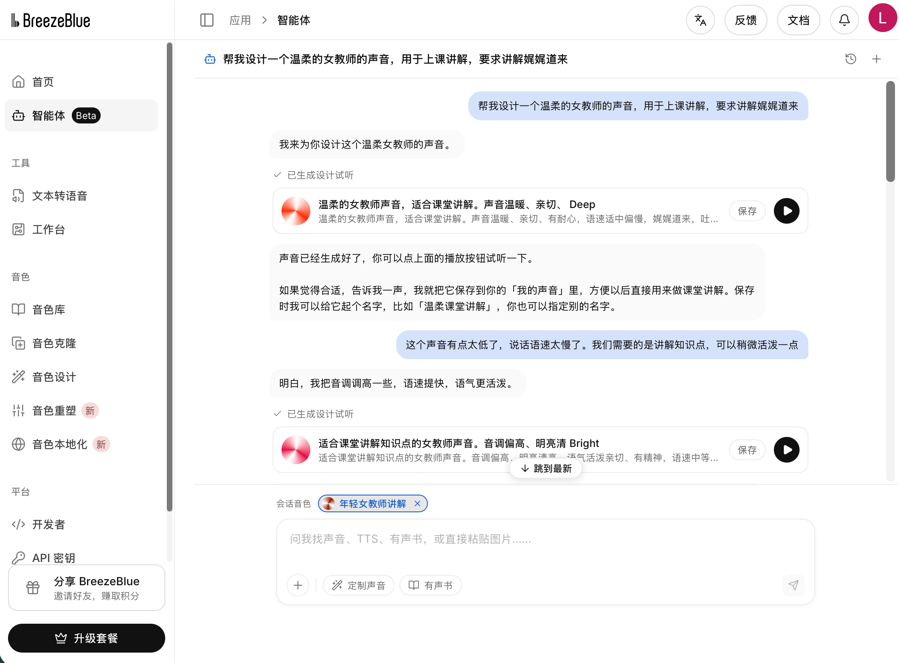
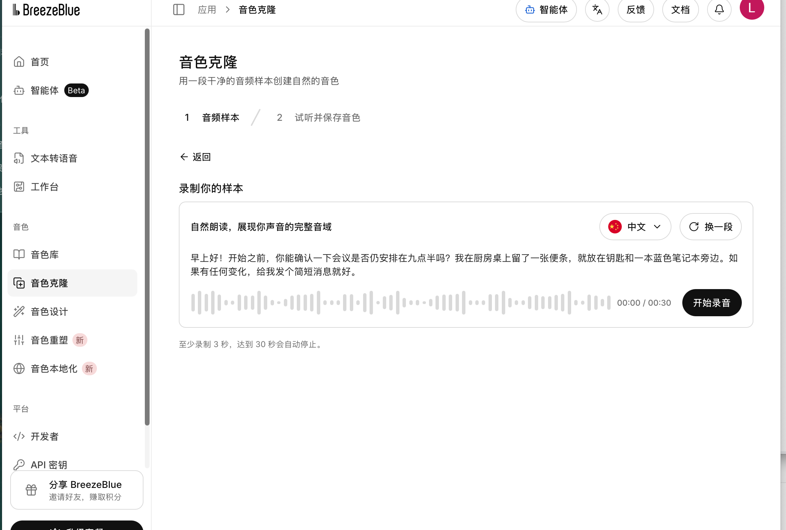
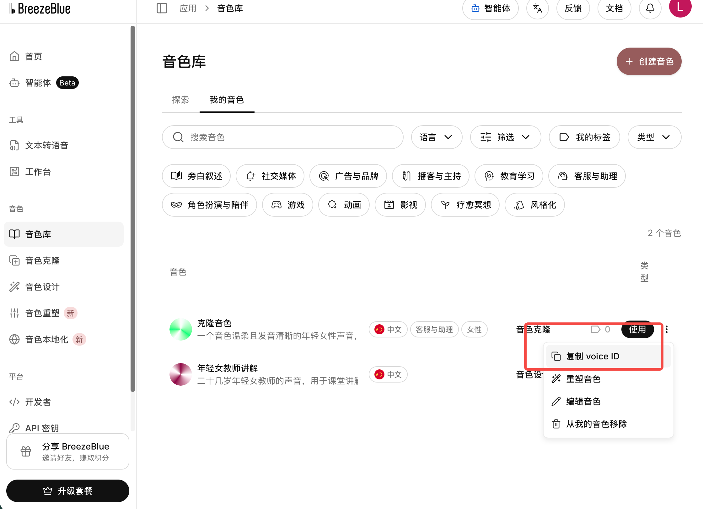

# 用自己的声音讲课：BreezeBlue × 知映KnowMotion

先在[BreezeBlue](https://breezeblue.ai/)选好或定制声音，再把Voice ID交给自己的智能体。知映负责把这个声音接到讲稿、分镜和视频中，工程仍可修改。

## 1. 定制并保存音色

**方式A：让网站智能体设计声音。** 打开“智能体”，描述你希望的声音，例如：

> 帮我设计一个用于初中课堂的女教师声音。普通话清晰、温和亲切，讲解娓娓道来，语速适中。举例时稍活泼，解释概念时有自然停顿。

试听后继续调整，如“音调明亮一点，语速稍快，保持课堂讲解的自然感”。满意后点击保存，放入“我的音色”。



**方式B：定制自己的个性化音色。** 打开“音色克隆”，按页面提示录制干净、自然的声音，试听并保存。使用自己的声音或已获得使用授权的录音。录音长度等限制以当前页面为准。



**方式C：音色本地化，让声音用于更多语言。** 在“音色本地化”中选择已有声音和目标语言，生成后试听、保存。可分别建立英语、日语、西班牙语等版本，每个保存后的声音有自己的Voice ID，原声音保留。适合长期制作多语言课程；偶尔朗读另一语言，也可以使用同一声音配合目标语言参数。这里的“本地化”指语言适配，不是把模型安装到本地电脑。[官方说明](https://docs.breezeblue.ai/guides/voice-localize)

**方式D：音色重塑，调整到适合自己的风格。** 在“音色重塑”中选择有权限使用的声音，用描述或预设调整，例如“音调明亮一些，讲解更有活力，保持自然亲切”。比较候选后保存新音色。重塑保留原语言，切换语言请使用本地化；保存后的候选作为独立声音，原声音不变。[官方说明](https://docs.breezeblue.ai/guides/voice-remix)

以上四种声音准备方式在Breeze网站操作，知映Skill接入保存后的Voice ID生成配音；目前没有把声音创建、克隆、本地化或重塑API封装为自动命令。

## 2. 创建API Key并复制Voice ID

- 在左侧“API密钥”创建自己的Key，保存到自己的凭据管理工具。
- 在“音色库→我的音色”，打开目标声音右侧菜单，选择“复制voice ID”。
- **API Key用于账号鉴权；Voice ID用于选择声音。** 不要把Key放到聊天、截图、HTML或GitHub。Voice ID可以作为配置值，但其他账号未必有权调用同一个声音。



三张图由项目作者提供，用于说明实际操作入口；未包含API Key。平台界面可能更新。

## 3. 先生成一段试听

安装本Skill并完成基础渲染环境配置后，把讲稿保存为`讲稿.txt`，在仓库根目录运行：

```sh
python3 scripts/breeze.py --text-file 讲稿.txt --voice-id voc_你的声音ID --out 试听.wav --prompt-key
```

终端提示后输入Key，输入不会回显。调用成功会保存原始WAV、试听WAV和来源记录。输入只在本次进程内使用，结束后清除。接口会消耗平台额度，失败不自动重试。

可直接给智能体发送：

> 请使用knowledge-to-video和Breeze声音。Voice ID是我提供的ID，API Key让我在终端隐藏输入。先按这份教材生成一小段试听，确认后再用于视频。定义讲清楚，举例自然连贯，字幕随实际新音频重新对齐。

## 4. 用这个声音制作视频

```sh
python3 scripts/project.py init --out 我的知识点 --title 模型训练 --profile assets/profiles/breeze-api.json
```

把生成工程的`voice.speaker`改为自己的ID。该模板是教学起点，还需智能体根据教材编写讲稿、分镜和动画。随后运行（镜头ID以工程实际值为准）：

```sh
python3 scripts/breeze.py --project '我的知识点/可编辑工程/工程数据.json' --scene s01 --prompt-key
```

确认试听后，可去掉`--scene`为当前工程缺少有效音频的镜头生成配音。编辑器“生成配音”也走同一个Breeze适配器；服务端进程需要提前安全配置`BREEZE_API_KEY`和`KTV_ALLOW_CLOUD_TTS=1`。网页里不填Key。

每次修改旁白或声音后重新配音、校准画面与字幕，再导出有声MP4和SRT。未配置对齐工具时保留待校准状态，不沿用旧字幕。SRT只包含文字与时间码，不包含声音。

## 5. 制作多语言版本

先完成目标语言讲稿和术语核对，再选用同一声音或已保存的本地化声音。每种语言建立独立工程，例如“模型训练-中文”和“模型训练-English”。英语工程的voice配置可以写成：

```json
{
  "backend": "breeze",
  "modelFamily": "BreezeBlue-TTS",
  "speaker": "voc_你保存的声音ID",
  "modelId": "breeze-tts-2-multilingual",
  "languageCode": "en",
  "instruction": "Explain warmly and clearly, with natural pauses after definitions.",
  "guidanceScale": 1,
  "speed": 1
}
```

将对应旁白和逐镜表达指令改为英语，再用上面的`--project`命令生成；日语可用`ja`、西班牙语可用`es`、法语可用`fr`。`languageCode`用于语音语言处理，不能替代翻译。Breeze官方多语言模型文档列出51种语言，实际模型与账号可用性以平台为准；本项目当前真实试听是中文，其他语言尚未逐项实测。[支持语言与模型](https://docs.breezeblue.ai/concepts/multilingual)

每种语言重新生成音频、对齐字幕和动画，检查发音及文本排版。不要直接沿用中文版本的字幕时间码。独立试听命令当前默认中文，多语言使用工程配置；音色设计/本地化的试听也可先在平台完成。

## API调用方式

适配器使用官方同步接口：`POST https://api.breeze.blue/v1/text-to-speech/{voice_id}?output_format=wav&delivery=sync`，通过`xi-api-key`请求头鉴权。请求体包含`text`、中文语言码`zh`、`instructions`及`voice_settings.guidance_scale`。源码：[适配器](../../scripts/lib/breeze_voice.py)。

讲课的音色身份由Voice ID决定，当前镜头的表达由instructions决定。例如：

```json
{
  "text": "训练，是用数据和反馈调整模型参数的过程。",
  "language_code": "zh",
  "instructions": "温和清晰地讲课，定义稍慢，强调数据、反馈与参数。",
  "voice_settings": {"guidance_scale": 1}
}
```

本实现不上传教材或视频，不接收任意服务地址；只支持同步WAV。异步、流式和Breeze时间戳接口尚未集成。模型ID默认由服务选择，可在工程voice.modelId中显式设置账号支持的模型。

## 实测与试听

此前`voc_4ewnvwb5pesp`已完成本地短视频适配，作者反馈测试成功。本次使用`voc_nc4uny6vhms2`真实调用同步接口，生成了 **28.32秒** 的“模型训练”课堂试听（2026年10月29日）。

**[▶ 播放或下载新音色试听MP3](media/teacher-voc_nc4uny6vhms2.mp3)** · [对应讲稿](media/teacher-script.txt)

GitHub未显示播放器时，可点击音频文件页的Raw或Download。

这段试听先解释训练，再用投篮中的反馈与调整作类比，最后说明模型实际调整的是参数。使用中文表达指令、guidance_scale=1、原始语速；只做响度归一化与MP3转码。未显式指定model_id，由服务自动选择。

已核对Voice ID、音频时长及完整解码，未将技术成功等同于听感通过。自然度、发音及课堂适用性请实际试听判断；这条音频展示不代表完整视频的音画对齐已经验证。源码中的 `tests/evidence/breeze-live-demo.json` 保留音频指纹与验证范围。

## 官方参考

- [文本转语音接口](https://docs.breezeblue.ai/api-reference/text-to-speech/convert-text-to-speech)
- [声音表达指令](https://docs.breezeblue.ai/guides/voice-instruction-prompting)
- [Skill接入与计时规则](../../references/11-breeze-api.md)

本教程使用网站设计、克隆、本地化和重塑声音，Skill调用已保存声音。账号权限、费用及声音许可按平台当前规则执行；不承诺示例私有ID可被所有账号调用。
