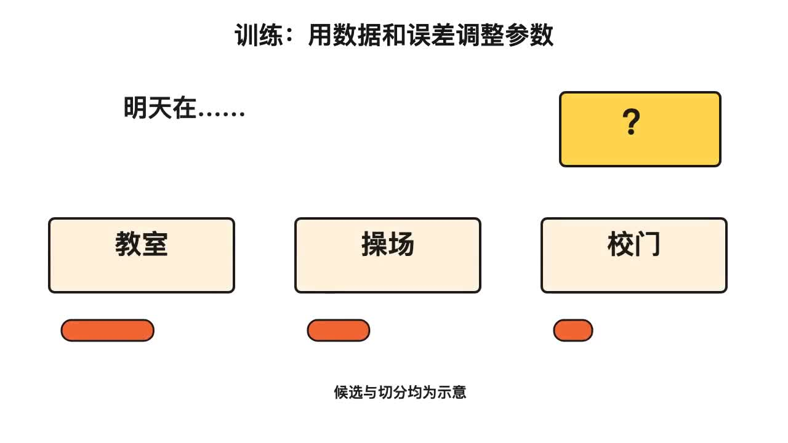
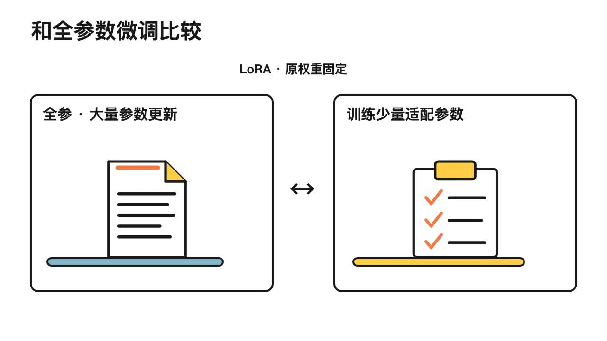

# 先看有声视频案例

先观看实际视频，再决定是否安装Skill。以下MP4均包含旁白；GitHub未显示播放器时，可点击文件页中的Raw或Download下载观看。

| 视频 | 时长 | 入口 |
| --- | --- | --- |
| 新版项目讲解与操作演示（Serena旁白＋重点文字） | 约1分54秒 | [观看或下载MP4](media/project-demo.mp4) |
| 训练与推理 机制动画片段 | 约32秒 | [观看或下载MP4](media/training.mp4) |
| 为什么需要模型评测 | 约26秒 | [观看或下载MP4](media/evaluation.mp4) |
| LoRA参数适配示意 | 约19秒 | [观看或下载MP4](media/lora.mp4) |
| RAG先查资料再回答 | 约23秒 | [观看或下载MP4](media/rag.mp4) |
| 训练与推理完整可编辑样例 | 约3分11秒 | [观看完整MP4](../../examples/notice-training/训练与推理可编辑示例.mp4) · [查看工程](../../examples/notice-training) |

| 训练与推理 | 模型评测 |
| --- | --- |
|  |  |
| LoRA | RAG |
|  |  |

需要自己制作或修改课程时，请克隆仓库并按使用指南运行源码与可编辑工程。展示入口只提供可直接观看或下载的MP4，不再附需要本地环境的HTML和JSON链接。

新版演示采用 Serena 女声、简短重点文字、训练机制动画与真实本地界面操作。课程切换按实际配音锚点校准，重配音和导出在片中以流程说明呈现。

## 案例依据与展示范围

案例直接基于GitLink上[Christin-liu / Full_Link_Development_of_Large_Models](https://www.gitlink.org.cn/Christin-liu/Full_Link_Development_of_Large_Models)仓库中“两天培训材料包”的知识点和实践任务开发，材料包源于《大模型全链路开发：基于书生开源体系的项目实战》。前五课共有27支独立知识点视频，修订版、短片与剪映副本不重复计数；这里公开精选案例和一套完整可编辑样例。

片段保留真实合成旁白和已制作动画，来源课次、时间区间和文件指纹保留在源码素材记录中。演示展示工程与画面效果；学校试点及教师学生学习效果测量属于后续计划。第三至第五课片段为历史实例，尚未全部按v1.3重制。原教材、未授权角色和个人材料未上传。
