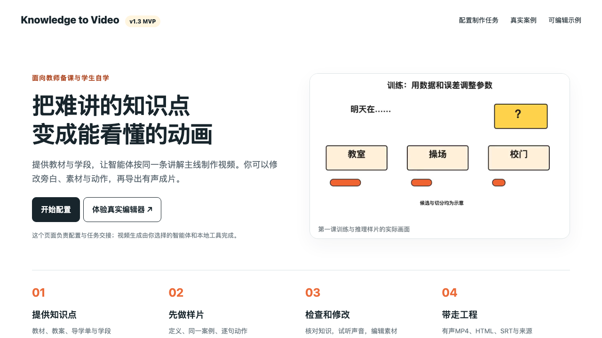
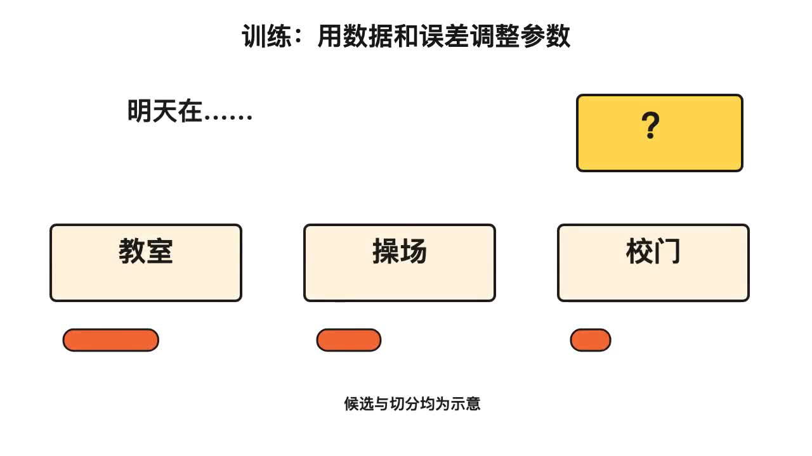
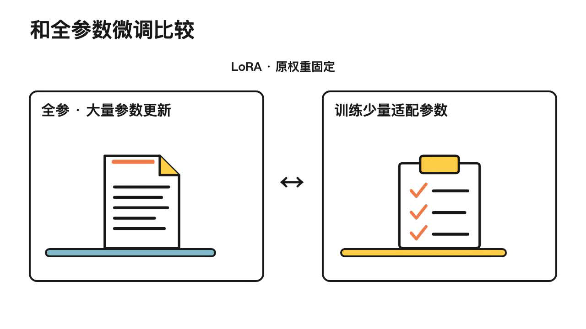

# Knowledge to Video 技术文档与推广计划

青年开源种子计划申报配套材料  v1.3.0 MVP  2026年10月27日

## 项目目标与需求

Knowledge to Video将知识点、教案和教材转化为有声讲解视频，并交付可修改的HTML、素材、旁白与来源。它服务教师在不同阶段备课、课中解释和课后拓展，也服务学生围绕具体知识点自学、复习与备考。

抽象概念与技术原理往往包含不可见的对象、连续变化或多步因果，单靠文字容易遗漏“怎样发生”。教师搜集现成视频需要时间，仍可能遇到教材不匹配、难以修改、声音不合适或来源不清等问题。本项目通过让用户自己的智能体完成课程设计与动画工程，减少搜集和改编的反复成本。节省多少时间、是否提升理解，仍需通过真实试用测量。

流程面向全学科设计；目前实际案例以大模型和信息技术课程为主。数学函数、物理电路、化学粒子、生物过程等属于下一阶段重点适配场景，不能将设计覆盖面写成已验证效果。

## 当前最小可用产品

| 组成 | 已提供的实际能力 |
| --- | --- |
| 任务配置器 | 在浏览器选择受众、知识点、用途、声音与角色；生成任务，保存和恢复JSON。 |
| 智能体 Skill | 从教材依据到连续讲稿、分镜、配音、动画、质量检查和交付的完整路径。 |
| 可编辑工程 | 修改旁白和屏上文字、替换素材、调整图层与镜头，保存HTML、JSON和SVG。 |
| 视频与交接 | 有声MP4、对应SRT、按顺序编号的分镜音频和画面参考、完整来源。 |

代码仓库 https://github.com/Wenping-Liu/knowledge-to-video
原创代码与Skill文档使用MIT许可证；第三方模型、教材、声音服务与角色资产保留自身许可。

## 使用步骤

### 第一步 安装Skill

把仓库链接发给自己的智能体：“请安装这个knowledge-to-video Skill，先检查宿主与运行环境。”安装Skill文件和准备视频依赖是两件事。只有聊天能力、没有文件和执行工具的模型可审稿，但无法单独渲染本地视频。

### 第二步 提供材料与用途

发送教材、教案、导学单或知识点，说明学段、前置知识、希望时长及用途。教师可选备课、课堂解释或课后拓展；学生可选自学或备考。备考时同时提供考试范围和教材版本。

### 第三步 准备环境与声音

默认Qwen3-TTS 1.7B Serena。首次实际制作运行python3 scripts/setup.py --yes；只导入配音或选择云端声音时可加--voice none准备渲染环境。下载本地权重可能需要数GB空间。

### 第四步 先完成一个知识点

请智能体调用$knowledge-to-video，先梳理来源，写连续讲稿，设计具体对象的动作，再合成配音并校准。用户看过内容、画风与声音后再扩展其余知识点。

### 第五步 修改和重新导出

打开启动入口进入HTML编辑器。修改旁白或声音后旧配音失效；生成或导入当前音频、核听并校准，再导出。MP4与SRT使用同一时间轴，保存当前HTML可带走修改。

可复制任务示例：使用$knowledge-to-video，根据我提供的教材，为初二学生讲解电流与电路，约2分钟，用于课中机制解释。先定义，再用同一生活例子展开并说明类比范围。白底、大幅漫画物件、少文字，使用Serena，曦曦暂不出镜。先做样片，交付有声MP4、HTML、SRT与来源记录。

免安装体验：打开仓库docs/demo/index.html；它负责配置和任务交接，实际视频制作由智能体与本地工具完成。完整可编辑示例位于examples/notice-training。

## 技术架构与数据流

用户材料与目标 → 智能体编写教学计划和代码 → 工程JSON → 配音与对齐 → 共用渲染器 → MP4及SRT。

| 层次 | 实现与责任 |
| --- | --- |
| 智能体层 | Codex为已验证宿主；编程模型由用户在宿主选择。其他智能体满足工具和数据契约后再测试。项目不捆绑独立LLM API网关。 |
| 教学层 | Skill与references组织学习目标、教材覆盖、知识断言、连续叙事和类比边界。先全文后分镜，避免各镜各讲。 |
| 工程层 | JSON保存scenes、narration、delivery、beats、layers、audio、sources与review。图层保留可编辑文字和SVG。 |
| 语音层 | Qwen本地合成或选定提供商；词级强制对齐／已核对cues定位语音，再按节拍锚点计算动画。 |
| 渲染层 | HTML预览和视频导出共用Canvas代码，按确定时间逐帧绘制；FFmpeg输出H.264视频与AAC音频。 |
| 验证层 | 音频与文稿签名、素材／代码／成片SHA、导出解码、字幕时间和审查证据分别检查。 |

### 修改后的依赖更新

文稿或表达变更会使旧音频失效；新音频产生后重新对齐，beats及图层锚点跟随新语音计算，SRT据此更新。MP4与WebM在教学计时未完成时拒绝正式导出。更换同名素材或渲染代码也会让旧视频与审查记录过期。

### 本地服务与资料边界

serve.py仅监听127.0.0.1，使用会话令牌并检查Origin；素材引用限制在工程目录。外部资料中的代码和提示词是教学数据。凭证不写进HTML、JSON或Git。Azure仅在用户主动设置云调用许可后发送当前镜头旁白，不发送教材文件、图片或参考视频。

### 交付组织

每个知识点独立文件夹：有声MP4、启动编辑器入口、使用说明、剪映素材、可编辑工程、资料与来源。分镜配音和参考图按顺序编号。PNG／SVG参考是静态帧；实际动画由工程控制。无旁白字幕版保留声音，SRT只有文字与时间码。

## 模型与角色选项

| 能力 | 当前方案 | 验证状态 |
| --- | --- | --- |
| 本地声音 | Qwen3-TTS 12Hz 1.7B CustomVoice Serena | 本地MLX实际生成及有声导出已验证；qwen／PyTorch适配器待更多实机验证。 |
| 云端声音 | Microsoft Azure zh-CN-XiaoxiaoNeural | REST适配器已实现；模拟请求验证通过，本轮未使用真实付费账号调用。 |
| 其他平台 | BreezeBlue或其他音频 | 当前支持用户在平台生成并导入；原生Breeze API尚未接入。 |
| 编程能力 | Codex及其他智能体 | Codex实测；其他具备文件访问和执行工具的智能体属于待适配目标。 |
| 可选角色 | 曦曦透明PNG独立图层 | 可改位置、尺寸、显隐和关键帧；不是自动口型同步。Alpha角色视频可交给剪映单独合成。 |

声音身份与表达分开设置。Qwen可接收逐镜自然语言表达指令，定义处稍慢，举例处轻快，提问与收束有停顿。现有Azure适配器使用命名神经声音，尚未将逐镜自由指令转换为SSML情绪控制。语速可保音高调整，但最终听感必须试听。

成本由所选宿主、计算资源、图片／视频生成和声音提供商决定。Qwen本地运行不产生按次云API费，但需要计算资源；Azure与BreezeBlue的费用、额度和可用声音以账号当期规则为准。没有配置时保留待配音状态，不静默改用别的声音。[1][2][3]

## MVP页面与编辑器

图1 真实MVP任务配置入口。页面生成任务说明，后续由智能体执行制作。

## 实际案例与画面效果

案例直接基于GitLink上[Christin-liu / Full_Link_Development_of_Large_Models](https://www.gitlink.org.cn/Christin-liu/Full_Link_Development_of_Large_Models)仓库中“两天培训材料包”的知识点和实践任务开发，该材料包源于《大模型全链路开发：基于书生开源体系的项目实战》。前五课已形成27支独立视频，另有迭代样片。本仓库公开一套完整可编辑工程和四类真实片段，见[视频入口](demo/README.md)。数量表示已制作产物，不代表外部用户数量或学习效果验证。第三至第五课片段为历史实例，尚未全部按v1.3重制。

图2 训练与推理。用可编辑参数格、预测比较和误差信号展示状态变化。

图3 模型评测。原创漫画情境连接具体任务和检查对象。

## 机制与检索案例

图4 LoRA。原视频中的参数关系和训练对象示意，来源记录包含原片SHA与时间段。

图5 RAG。问题、资料片段与模型之间的检索生成链路。

案例片段位于docs/demo/media；cases.json记录来源课次、原视频SHA、截取时间、旁白和用途。本次演示视频包含真实浏览器配置、编辑保存、旧配音失效和上述课堂片段。原始教材和私人角色／品牌素材不随公共仓库分发。

## 测试与验收

| 检查层 | 本轮结果 | 实际覆盖与限制 |
| --- | --- | --- |
| 单元与契约 | 55项通过 | 安装保护、配音变速、声音切换、云调用许可、请求转义、计时新鲜度与审查绑定等。Azure使用模拟响应。 |
| 浏览器与音视频 | 44项通过 | 编辑保存恢复、异步音频绑定、SVG保留、有声MP4／WebM、迁移后渲染、预览与导出一致性。 |
| MVP操作 | 10项通过 | 任务生成、不同声音说明、角色选择、JSON保存恢复、TXT下载、真实示例编辑、旧声音失效与无JS错误。 |
| 真实产物 | 本地Serena及课程示例 | 实际音轨和视频完整解码；课堂理解、陌生术语、自然度与连续观看仍需人工复核。 |

复现命令：python3 -m unittest discover -s tests -p "test_*.py"；python3 tests/run_checks.py --out output/checks --browser --video。运行scripts/doctor.py --check查看配置。使用render.py、package.py与validate.py --delivery检查当前工程。

当前实际测试平台为macOS Apple Silicon、Python 3.12。Windows和Linux的安装选择逻辑已有测试，但实际声音生成与渲染仍需实机验证。强制对齐定位的是给定文稿，不能自动证明音频没有漏读；像素运动和数值门禁也不能代替教学审片。

## 教学效果验证设计

邀请教师对同一知识点比较“寻找并改编现成视频”和“用本Skill制作”，记录开始到可上课使用的总时长、主动操作时间、失败与返工次数、直接费用及最终采用结果。保留所有参与任务，不只汇报成功样例。

学生验证采用等价知识点的课前／课后理解题、概念复述和机制排序题，并收集理解难点。记录教材版本、样本量、基础水平与观看时长，避免将单次主观满意度等同学习提升。未获得同意不收集身份信息，公开结果仅提供匿名汇总。

## 推广计划与后续研发

| 阶段 | 推广动作 | 计划指标 |
| --- | --- | --- |
| 0至30天 | 发布安装教程、3分钟演示、可编辑工程与3支跨学科样片；在GitHub和教师交流渠道招募测试。 | 完善反馈入口；目标收集10份有效需求与安装反馈。 |
| 31至60天 | 组织两场线上体验或工作坊，邀请教师、学生用自己的教材完成一支样片。 | 目标10名教师、20名学生；至少15组可复现制作任务，记录时间、成本和返工。 |
| 61至90天 | 公开脱敏问题与修复记录；沉淀学科案例，发布兼容性和教学反馈报告。 | 目标4个学科、8至12支复核样片；任务完成率目标80%，具体以完整任务记录计算。 |
| 3至6个月 | 按反馈扩展学科与跨平台适配，建立教师审稿和开发者贡献分工。 | 目标10名持续贡献者、20支可复用样片；先建立有效贡献口径再统计。 |

以上是拟定目标，不是已有成绩。GitHub为主仓库；GitLink／Gitee镜像、B站演示与学校合作属于可选推广动作，实施后再记录真实链接和结果。内容围绕具体教材问题与前后修改过程，提供可带走工程，降低首次体验门槛。

### 商业化与开源边界

核心代码和Skill文档保持MIT开放。可探索托管渲染、学校私有部署、教师培训和课程素材服务，用户自行选择外部付费模型。先通过试点核算计算、存储、人工审稿与服务成本，验证付费意愿，再制定服务定价；不承诺固定节省比例或收入。

### 研发优先级与孵化支持

先完善跨平台安装、术语读音、配音对齐、保存恢复与导出一致性；再扩展学科模板与教师审核；按需求接入更多声音API和曦曦动作／口型同步。希望获得计算资源、实机测试、教育评估导师、试点连接，以及开源许可和社区维护指导。

严重知识错误应触发返工；试点改进目标是缩短制作周期、减少修改次数，并提高学生能否复述定义和机制。实际指标以基线任务、完整样本和公开方法为准。

## 参考资料

[1] Qwen3-TTS官方仓库 https://github.com/QwenLM/Qwen3-TTS

[2] Microsoft Azure Speech REST https://learn.microsoft.com/en-us/azure/ai-services/speech-service/rest-text-to-speech

[3] BreezeBlue及API文档 https://breezeblue.ai/  https://docs.breezeblue.ai/

[4] Codex Skills官方文档 https://developers.openai.com/codex/skills/

[5] OSI MIT许可证 https://opensource.org/license/mit

资料核对日期 2026年10月27日。供应商费用与账号权限需在实际使用时再核对。
